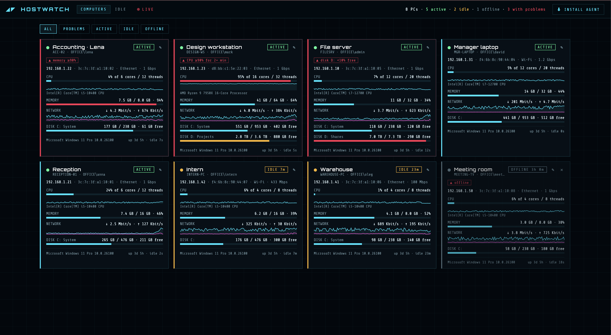
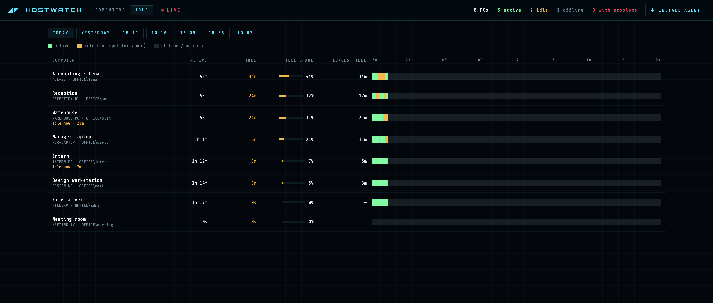
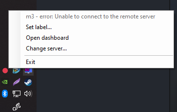

# hostwatch

Панель здоровья Windows-компьютеров в локальной сети. На каждом ПК работает
маленький агент, раз в секунду он отправляет данные на сервер, а сервер
показывает их в браузере.

**Что видно по каждому ПК:** метка, имя, пользователь, IP и MAC, CPU, память,
диски, сетевой трафик, аптайм и статус:
- **ACTIVE** — за компьютером работают;
- **IDLE** — 2 минуты без мыши и клавиатуры (только в рабочее время);
- **OFF-HOURS** — сейчас нерабочее время, простой не считается;
- **OFFLINE** — 30 секунд нет отчётов.

Компьютеры с проблемами (CPU ≥90% дольше 2 минут, память ≥90%, на диске
меньше 10% свободного) показываются первыми. На вкладке **IDLE** видно,
сколько каждый ПК был активен и сколько простаивал за день (история ~2 месяца, выбор даты).

На карточке рядом с IP есть две кнопки подключения:

- **RDP** — скачивает `.rdp` и открывает удалённый рабочий стол (Windows —
  `mstsc`, Mac — Microsoft Remote Desktop). Это **новая** сессия: пользователь,
  сидящий за ПК, будет выкинут. Нужен включённый Remote Desktop (Windows Pro+;
  Home входящий RDP не умеет) и учётные данные.
- **SHADOW** — подключение к **текущей** сессии пользователя (RDP shadowing):
  видишь и управляешь его экраном без перелогина — то, что нужно для помощи
  сотрудникам. Скачивает `.cmd` с `mstsc /shadow:<id> /v:<ip> /control`.

Условия для SHADOW:

- запускать `.cmd` надо с **Windows** (у Mac shadow не поддерживается);
- ты должен быть **админом на целевом ПК** (обычно через доменную учётку/GPO);
- на целевом ПК открыть в брандмауэре правило для теневого подключения:
  `netsh advfirewall firewall set rule group="Remote Desktop" new enable=Yes`;
- по умолчанию пользователь увидит запрос «разрешить». Чтобы без запроса,
  настрой политику «Set rules for remote control of Remote Desktop Services user
  sessions» (GPO) или ключ `Shadow` в `HKLM\SOFTWARE\Policies\Microsoft\Windows
  NT\Terminal Services` (2 — управление с запросом, 4 — без запроса);
- `/control` в команде даёт управление; убери его для просмотра без управления.

Кнопка **free** в строке MEMORY просит агент освободить оперативку.

**Рабочее время.** Idle считается только в рабочие часы; вне их — статус
OFF-HOURS, и в логи простоя это не попадает. По умолчанию таймзона
`Asia/Baku`, часы 09:00–12:00 и 14:00–18:00. Поменять можно прямо на вкладке
**IDLE** (кнопка **✎ EDIT** у строки WORK HOURS) — сохраняется в `config.json`,
перезапуск не нужен. Чтобы время на шкале совпадало с рабочими часами, держи
сервер в той же таймзоне.





## Сервер

Подойдёт любая машина в сети: Windows, Mac или Linux. Нужен Python 3.9+
(или Docker).

**Windows.** Поставь Python с [python.org](https://www.python.org/downloads/),
при установке отметь **Add python.exe to PATH**. Потом в папке проекта:

```
run.cmd
```

Один раз открой порт в брандмауэре (cmd от администратора), иначе агенты не
достучатся:

```
netsh advfirewall firewall add rule name=hostwatch dir=in action=allow protocol=TCP localport=8765
```

**Mac / Linux:**

```bash
./run.sh
```

При первом запуске скрипт сам создаст `.venv` и поставит зависимости, дальше
просто запускает сервер. Остановить — `Ctrl+C`. Если обновились зависимости
(`server/requirements.txt`), удали папку `.venv` и запусти снова.

**Docker:** `docker compose up -d --build`.

Панель: `http://<IP сервера>:8765`. Данные хранятся в `server/data/` (при
Docker — в `data/`).

### Пароль

С самого сервера (`http://localhost:8765`) панель открывается без пароля. С
других устройств браузер спросит пароль (имя пользователя любое). Пароль
лежит в `server/config.json` (при Docker — `data/config.json`):

```json
{
  "password": "придумай-пароль"
}
```

Образец — `server/config.example.json`. Пароль подхватывается без
перезапуска. Пока файла нет, панель открыта только на сервере. Агентам пароль
не нужен: отчёты и скачивание агента работают без него. При запуске через
Docker пароль спрашивается и на самом сервере.

### Сменить адрес сервера сразу на всех ПК

Добавь в `config.json` поле `server_url` — агенты получат новый адрес в ответе
на очередной отчёт и сами на него переключатся (адрес сохранится и в их
автозапуске):

```json
{
  "password": "...",
  "server_url": "http://192.168.31.20:8765"
}
```

Это работает для **планового** переезда, пока агенты ещё достукиваются до
текущего сервера. Если IP уже сменился внезапно (DHCP при перезагрузке) и
старый адрес мёртв, агентам некуда прийти за новым — поэтому лучше сразу дать
серверу **стабильный адрес** (статический IP, DHCP-резервация или имя хоста
вроде `http://hostwatch:8765`), тогда менять ничего не придётся. Проверь новый
адрес на одном ПК (трей → **Change server**) прежде чем пушить на всех.

Настройки через переменные окружения: `HOSTWATCH_PORT` (8765),
`HOSTWATCH_IDLE_AFTER` (120 с), `HOSTWATCH_STALE_AFTER` (30 с).

## Агент (на каждом Windows-компьютере)

1. Открой панель в браузере на этом компьютере.
2. Нажми **⬇ DOWNLOAD AGENT** и запусти скачанный `hostwatch.exe`.
3. При первом запуске он спросит адрес сервера (потом помнит его сам).

Права администратора не нужны. Это обычная программа — без скрипта-запускалки
и скрытого PowerShell, что реже беспокоит антивирусы. При запуске exe копирует
себя в `%LOCALAPPDATA%\Hostwatch`, прописывается в автозагрузку и дальше
стартует вместе с Windows, работая в фоне с точкой в трее (голубая — всё
хорошо, красная — нет связи с сервером); занимает ~15–25 МБ памяти. Меню
иконки: **Set label…**, **Open dashboard**, **Change server…**, **Uninstall**,
**Exit**. Метку можно поменять и в панели (✎).

Тихая установка (для массовой раскатки): `hostwatch.exe -Server http://IP:8765`
— без окон, сам поставится и запустится. Удаление: пункт **Uninstall** в меню
или `hostwatch.exe -uninstall`.

#### Для всех пользователей ПК

Чтобы агент стартовал у **любого** вошедшего пользователя (и инфо о
пользователе обновлялось при смене аккаунта), нужна установка на всех. Для неё
достаточно запустить exe **от администратора** — он сам поставит себя в
`C:\ProgramData\Hostwatch` и пропишет автозапуск в `HKLM` (а не в профиль
пользователя). Варианты:

- вручную: правый клик по `hostwatch.exe` → **Запуск от имени администратора**;
- с флагом (запросит UAC сам): `hostwatch.exe -allusers -Server http://IP:8765`;
- через GPO/логон-скрипт от SYSTEM: `hostwatch.exe -allusers -Server http://IP:8765`.

При такой установке настройки (адрес сервера, метка, буфер офлайна) лежат в
`C:\ProgramData\Hostwatch` — **общие для всех пользователей**, а не в профиле;
папке выдаётся право записи для всех, и работает один агент на машину.
Пользователя для дашборда агент берёт из активной сессии (кто сейчас за ПК),
так что при смене аккаунта инфо обновляется.

Обычный двойной клик без прав админа ставит агент только для текущего
пользователя (настройки тогда в его `%LOCALAPPDATA%\Hostwatch`). Полное
удаление установки «для всех» делается тоже от админа: `hostwatch.exe
-uninstall` (из трея пользователь без прав снимет только свою часть).

Для запуска нужен `.NET Framework 4` — он есть в каждой Windows 10/11.



Первая строка меню — метка и последний статус отправки (здесь сервер был
недоступен).

### Как собрать агент

Готовый `agent/hostwatch.exe` лежит в репозитории, так что обычно собирать
ничего не нужно. Пересборка требуется, только если поменялся исходник
`agent/hostwatch-agent.cs`.

Сборка идёт встроенным в Windows компилятором C# (`.NET Framework 4`, есть в
любой Windows 10/11) — Visual Studio или .NET SDK не нужны. На Mac/Linux
собрать нельзя.

1. Скопируй папку `agent/` на любую Windows-машину.
2. Запусти `agent/build.cmd` (двойным кликом). Он соберёт `hostwatch.exe`
   рядом с исходником. Та же команда вручную:

   ```
   cd agent
   "%WINDIR%\Microsoft.NET\Framework64\v4.0.30319\csc.exe" /nologo /target:winexe /optimize+ /out:hostwatch.exe /r:System.Management.dll /r:Microsoft.VisualBasic.dll hostwatch-agent.cs
   ```

   На 32-битной Windows путь — `...\Framework\v4.0.30319\csc.exe` (без `64`);
   `build.cmd` это учитывает сам.
3. Проверь: `hostwatch.exe -Server http://<IP-сервера>:8765` — должна появиться
   точка в трее, а компьютер — на дашборде.
4. Положи новый `hostwatch.exe` обратно в `agent/` и закоммить.

Нужна Windows 10/11 (PowerShell 5.1 встроен).

## Демо

Чтобы посмотреть панель без настоящих агентов (или сделать скриншоты):

```
run.cmd demo      (Windows)
./run.sh demo     (Mac / Linux)
```

Запустится выдуманный офис из 8 компьютеров с историей за пару месяцев. В демо-режиме
ничего не сохраняется, настоящие данные не затрагиваются.

## Проверить кнопку «free»

Чтобы искусственно нагрузить память на ПК и проверить освобождение, запусти
на этом компьютере `tools/hog.ps1` — он держит ~4 ГБ в оперативке:

```
powershell -ExecutionPolicy Bypass -File hog.ps1
```

Запускай **под тем же пользователем**, что и агент (тогда агент почистит без
прав администратора; если агент работает с правами админа — почистит и чужие
процессы). Порядок:

1. На дашборде на карточке этого ПК **MEMORY** подрастёт на ~4 ГБ (за пару секунд).
2. Нажми **free** на той же карточке.
3. Через 1–2 секунды used снова упадёт — агент сбросил рабочие наборы, страницы
   ушли в standby (считаются свободными).
4. Enter в окне PowerShell — освободить тестовую память.

`$gb` в скрипте подстрой под объём ОЗУ (на 8 ГБ ставь 3–4, не больше).

## Как это устроено и как обновлять

Памятка на будущее: что где лежит, как собирать и как не запутаться в git.

### Структура

- `server/app.py` — сервер (FastAPI): приём отчётов, API, раздача дашборда и
  агента, история, команды (free RAM), бэкфилл, пуш адреса.
- `server/static/{index.html, app.js, style.css}` — дашборд.
- `server/demo.py` — выдуманный офис для демо/скриншотов (`HOSTWATCH_DEMO=1`).
- `agent/hostwatch-agent.cs` — **исходник** агента (C#).
- `agent/hostwatch.exe` — **собранный** агент, лежит в репозитории (его и качают
  клиенты с дашборда).
- `agent/build.cmd` — сборка exe из исходника (на Windows).
- `tools/hog.ps1` — скрипт для теста кнопки free.
- `server/config.json` — пароль дашборда, рабочие часы, `server_url` (не в git).

### Как меняется агент

1. Правишь `agent/hostwatch-agent.cs` (версия — в строке `const string Version`).
2. На любой Windows-машине запускаешь `agent/build.cmd` → получаешь свежий
   `hostwatch.exe` (см. раздел «Как собрать агент»).
3. Кладёшь новый exe обратно в `agent/`, коммитишь и пушишь.
4. Клиенты получают новую версию при переустановке (скачали с дашборда →
   запустили; exe сам обновляет свою копию). Адрес сервера можно сменить
   централизованно через `server_url` в `config.json` — см. выше.

Сервер отдаёт файлы с диска, поэтому после замены `hostwatch.exe` или правок
дашборда отдельная пересборка не нужна — только перезапуск сервера для нового
кода `app.py`.

### Статика дашборда (кэш)

Ссылки на `app.js`/`style.css` в `index.html` идут с версией `?v=N`. **Меняешь
`app.js` или `style.css` — увеличь N** (во всех ссылках), иначе у людей
останется старая версия из кэша браузера. После этого достаточно обычного
обновления страницы.

### Git: Mac + Windows

Исходник ты правишь на Mac, а exe собираешь и коммитишь на Windows — поэтому
ветки легко расходятся (коммиты есть и там, и там). Если `git push` пишет
`non-fast-forward`:

```
git pull --no-rebase
```

Это сольёт изменения (merge). Часто будет **конфликт в бинарнике
`agent/hostwatch.exe`** — git не умеет его мёржить. Бери любую сторону (всё
равно пересоберёшь из свежего исходника):

```
git checkout --theirs agent/hostwatch.exe
git add agent/hostwatch.exe
git commit --no-edit
git push
```

Чтобы `git pull` не переспрашивал про стратегию — один раз:
`git config pull.rebase false`.

Правило, чтобы не путаться: **исходник (`.cs`) — главное, exe — артефакт**.
После любого merge пересобери exe из текущего `.cs` на Windows и закоммить, чтобы
`hostwatch.exe` соответствовал версии в исходнике.
